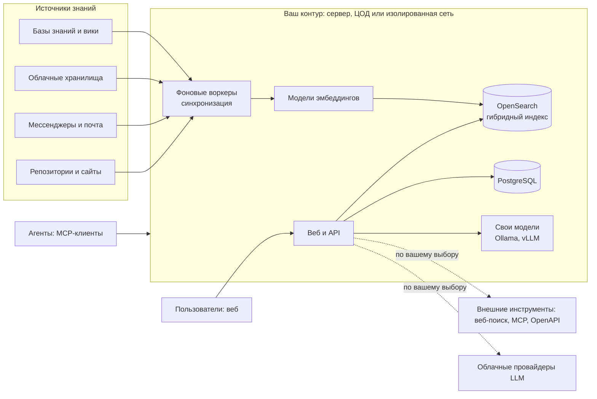

<a name="readme-top"></a>

<h2 align="center">
  <a href="https://www.yahont.ai">
    <picture>
      <source media="(prefers-color-scheme: dark)" srcset="web/public/logotype-dark.png" />
      
    </picture>
  </a>
</h2>

<p align="center">
  <a href="https://docs.yahont.ai" target="_blank">
    
  </a>
  <a href="https://t.me/yahont_ai" target="_blank">
    
  </a>
  <a href="https://www.yahont.ai" target="_blank">
    
  </a>
  <a href="https://cloud.yahont.ai" target="_blank">
    
  </a>
  <a href="LICENSE">
    
  </a>
  <a href="https://github.com/pipedude/yahont-ce/releases" target="_blank">
    
  </a>
  <a href="https://hub.docker.com/u/yahontai" target="_blank">
    
  </a>
</p>

<p align="center">
  <a href="#-демонстрация">Демонстрация</a> ·
  <a href="#-возможности">Возможности</a> ·
  <a href="#-как-это-работает">Как это работает</a> ·
  <a href="#-что-yahont-добавляет-к-onyx">Что нового</a> ·
  <a href="#-режимы-развёртывания">Режимы</a> ·
  <a href="#-быстрый-старт">Быстрый старт</a> ·
  <a href="#-сообщество-и-участие">Сообщество</a>
</p>

---

# Yahont — контекстный слой на базе всех ваших знаний и приложений

> «Языковые модели уже достаточно хорошо знают всё публичное и открытое.
> А что, если бы они знали и то, что происходит в нашем рабочем пространстве?
> Нам нужна настоящая супер-сила ИИ, а не еще один ИИ-ассистент!»

**Yahont** — слой знаний и контекста для вашей команды и ИИ-агентов.

Yahont подключается к вашим приложениям, индексирует и выводит знания из
любых источников данных. Ваши данные остаются под вашим контролем: Yahont 
разворачивается на ваших серверах. Каждый ответ содержит ссылки на документы, 
из которых он собран. Гибкие настройки и подключение любых LLM, локальных или облачных.

Помимо контекстного поиска, Yahont даёт языковым моделям расширенные возможности: 
веб-поиск, выполнение кода, генерацию изображений, голосовой режим, действия во внешних
системах и другое.

Yahont основан на открытом исходном коде проекта [Onyx](https://github.com/onyx-dot-app/onyx). 
Мы адаптируем его для России: русский интерфейс и документация, российские провайдеры 
моделей и поиска, модели эмбеддингов для русского текста, российские источники данных.

> [!NOTE]
> Это открытая версия Yahont CE (Community Edition). Cloud-версия и корпоративная
> версия (Enterprise Edition) находятся в стадии разработки.

> [!TIP]
> Запуск в несколько команд: см. [Быстрый старт](#-быстрый-старт).

---

## 🎬 Демонстрация

<!--
ВИДЕО-ЗАГЛУШКА. Пока в README есть эта строка, скрипт экспорта CE остановится.

Как добавить видео (проверено по документации и обсуждениям GitHub):
1. Откройте README.md в веб-редакторе GitHub (значок карандаша) или любой
   комментарий в Issue.
2. Перетащите файл .mp4 или .mov в окно редактора. GitHub загрузит видео и
   вставит ссылку вида https://github.com/user-attachments/assets/<идентификатор>.
3. Оставьте эту ссылку отдельной строкой ниже: GitHub покажет проигрыватель.
   Тег <video> с адресом файла из репозитория GitHub не показывает: он
   вырезает такие теги. Работает только ссылка user-attachments.
4. Проверьте лимит размера файла в GitHub (на бесплатном плане он небольшой).
5. Удалите весь этот комментарий и блок-заглушку ниже.

Запасной вариант, если файл слишком большой: загрузите видео на RuTube,
VK Видео или YouTube и вставьте картинку-превью со ссылкой:
[](https://адрес-видео)
-->

> 🎥 **Видео с демонстрацией интерфейса появится здесь.**
> Пока вы можете развернуть Yahont сами: [Быстрый старт](#-быстрый-старт).

---

## 💡 Для чего это нужно

| Задача | Как помогает Yahont |
|---|---|
| **Поиск по всем источникам** | Один запрос вместо поиска в каждой системе. Гибридный индекс находит документ и по смыслу, и по точному слову. |
| **Ответы с источниками** | Ответ собран из ваших документов и содержит ссылки на них, поэтому его можно проверить. |
| **Онбординг и поддержка сотрудников** | Новый сотрудник спрашивает о регламентах и инструкциях и получает ответ без обращения к коллегам. |
| **Помощники для команд** | Агенты со своим набором знаний и инструкциями: для поддержки, продаж, ИТ-службы. |
| **Исследования** | Режим глубокого исследования готовит подробный отчёт за несколько шагов. |
| **Сохранение знаний** | Решения и контекст остаются доступными, когда люди или команды меняются. |

---

> «Это не просто еще один чат с LLM, а выстроенный и эффективный рабочий процесс. 
> Каждый запрос это точечное исследование доступного контекста и внешних источников. 
> Минимизация галлюцинаций LLM за счет итеративного подхода и параллельных запросов с 
> последующим разбором и объединением результатов.»

## ⭐ Возможности

- **🔍 Поиск и ответы по документам (Agentic RAG).** Гибридный индекс
  (ключевые слова и векторы) и агент, настроенный на поиск информации.
- **🔬 Глубокое исследование (Deep Research).** Подробные отчёты в несколько
  шагов.
- **🤖 Агенты.** Свой набор знаний, инструкции и действия для каждого агента.
- **📁 Проекты и файлы.** Загрузите документы в чат или проект и задавайте
  вопросы по ним.
- **🌐 Веб-поиск.** Дополняет ответы свежими данными из интернета: srezai.ru
  (работает в России без VPN), Serper, Brave, Tavily, SearXNG, Firecrawl.
  Есть встроенный сканер сайтов.
- **🧩 Действия и MCP.** Агенты выполняют задачи во внешних системах и
  подключают серверы MCP.
- **🔌 MCP-сервер.** Подключите Yahont как источник знаний к внешним агентам и
  MCP-клиентам, например к Claude Desktop: агент ищет по вашим документам тем же
  поиском, что и чат. 
- **💻 Выполнение кода.** Агент запускает код в изолированной песочнице.
- **🖼️ Генерация изображений.** Создание и правка картинок через подключённые
  модели.
- **🎙️ Голосовой режим.** Распознавание и синтез речи.

**🧠 Модели.** Подключайте российские шлюзы RouterAI и Polza.ai, облачных
провайдеров (OpenRouter, OpenAI, Anthropic и других) или свои модели через
Ollama, vLLM, LiteLLM и LM Studio. Для работы нужны ключи выбранных вами
провайдеров.

### 🔌 Источники знаний

Более 50 источников.

**Общие коннекторы** 

из Onyx:

- **Файлы и сайты:** загрузка файлов, сканер сайтов.
- **Wiki и трекеры:** Confluence и Jira (Cloud, Server и Data Center), GitLab,
  GitHub.
- **Базы знаний:** BookStack, Outline, MediaWiki, GitBook.
- **Google:** Google Drive, Gmail, Google Sites.
- **Почта по IMAP:** любой почтовый сервер, в том числе корпоративный.
- **Хранилища:** Amazon S3, Google Cloud Storage, Oracle Cloud Infrastructure.
- **Коммуникации:** Discord, Zulip, Zoom.

**Российские коннекторы**

уже подключены:

- **Яндекс Почта и Mail.ru** по IMAP, с поддержкой русских папок и заголовков.
- **S3-совместимые хранилища:** Yandex Object Storage, VK Cloud, Selectel,
  Cloud.ru, Timeweb Cloud, MinIO и другие.

в процессе разработки:

- **Яндекс Диск** и **Яндекс 360** (режим организации).
- **Bitrix24, amoCRM** и **МойСклад:** сделки, контакты, задачи, файлы.
- **1С:Предприятие:** загрузка документов через Ingestion API.
- **СБИС и Контур.Диадок:** документы торговли и электронного
  документооборота.

Порядок и набор коннекторов определяются запросами сообщества: напишите, какой источник 
нужен вам, в [Telegram](https://t.me/yahont_ai).

---

## 🧭 Как это работает

Yahont строит представление знаний по всем подключённым источникам: забирает
документы и метаданные, разбивает на фрагменты, считает эмбеддинги и записывает
в гибридный индекс. На вопрос система сразу находит нужные фрагменты в индексе и
передаёт их модели. Агенту не нужно перебирать десятки систем и тратить на это
токены.



### 🔒 Безопасность данных

Все компоненты работают на ваших серверах: индекс документов, база данных и
обработка. С локальными моделями эмбеддингов и LLM данные не покидают ваш
контур. Облачных провайдеров моделей вы можете использовать по своему усмотрению.

---

## 💎 Что Yahont добавляет к Onyx

Состояние на 18 октября 2026.

### ✅ Реализовано

- **Русский язык.** Интерфейс полностью переведён, русский язык установлен по умолчанию.
  Документация — [docs.yahont.ai](https://docs.yahont.ai).
- **Эмбеддинги для русского текста.** Модель по умолчанию —
  `intfloat/multilingual-e5-small` (мультиязычная).
- **Дополнительный веб-поиск для агентов.** Поиск и чтение страниц через srezai.ru.
- **Российские шлюзы моделей.** RouterAI и Polza.ai подключаются как провайдеры
  в разделе «Шлюзы и роутеры».
- **Яндекс Почта и Mail.ru.** Пресеты IMAP с исправлениями для российской почты.
- **S3-совместимые хранилища.** Один коннектор для любых российских и зарубежных
  провайдеров.
- **Готовые образы в Docker Hub.** `docker compose up -d` скачивает образы
  `yahontai/yahont-ce-*`, локальная сборка не нужна.

### 🔧 В работе

- **Качество эмбеддингов:** тестирование новой модели на российских данных.
- **Описание изображений:** сравнение vision-моделей на русских сканах.

### 📅 Запланировано

- **Вложения писем** (PDF, DOCX, XLSX) в Яндекс Почте, Mail.ru и IMAP. Сейчас
  индексируется только тело письма.
- **Telegram-бот** по аналогии со Slack-ботом: ответы в личных сообщениях,
  автоответы в выбранных группах и каналах. 
- **Вход через Яндекс ID.**
- **Поиск через Yandex Search API.**
- **Другие российские коннекторы.**

Подробный список изменений — в [CHANGELOG.md](CHANGELOG.md).

---

## 🧩 Режимы развёртывания

Yahont запускается в Docker Compose в двух режимах: стандартном и лайт. Режим
выбирается набором файлов Compose.

| | 🏗️ Стандартный | 🪶 Лайт |
|---|---|---|
| **Для кого** | Командам, которым нужны знания из своих источников | Для быстрой пробы интерфейса и команд, которым нужен только ИИ-чат |
| **Что запускается** | Все сервисы: 11 контейнеров | PostgreSQL, API, веб, `nginx` и выполнение кода: 5 контейнеров |
| **Минимум ресурсов** | 4 vCPU, 10 ГБ ОЗУ, диск 32 ГБ + ~2,5× проиндексированных данных | 2 vCPU, 2 ГБ ОЗУ, диск 10 ГБ |
| **Рекомендуется** | 8+ vCPU, 16+ ГБ ОЗУ, диск 500 ГБ для организаций до 5000 пользователей | 4 vCPU, 4 ГБ ОЗУ, диск 50 ГБ |
| **Источники знаний и коннекторы** | ✅ | ❌ |
| **Поиск по документам, знания агентов** | ✅ | ❌ |
| **Чат с моделями, агенты с инструкциями и инструментами** | ✅ | ✅ |
| **Файлы и изображения в чате** | ✅ | ✅ |
| **Выполнение кода** | ✅ | ✅ |

Лайт в базовом режиме использует меньше 1 ГБ памяти. Память и диск растут с
числом загруженных файлов, потому что в лайте файлы хранит PostgreSQL.
Подробнее о ресурсах:
[docs.yahont.ai/deployment/getting_started/resourcing](https://docs.yahont.ai/deployment/getting_started/resourcing).

#### 🏗️ Стандартный режим

Полный набор возможностей Yahont. Рекомендуем его для серьёзной работы и больших
команд. В лайте нет этих компонентов:

- гибридный индекс (OpenSearch) для поиска по документам;
- фоновые воркеры, которые синхронизируют знания из коннекторов;
- серверы моделей эмбеддингов для индексации и поиска;
- Redis и объектное хранилище для производительности и файлов.

#### 🪶 Лайт

Лайт можно считать лёгким интерфейсом ИИ-чата. В базовом режиме он использует
меньше 1 ГБ памяти и не умеет индексировать документы: коннекторы, поиск по знаниям и знания агентов
отключены. Подходит, чтобы быстро попробовать интерфейс или если команде нужны
только чат и агенты.

Запуск лайта установщиком — параметр `--lite` (`-Lite`), см.
[Быстрый старт](#-быстрый-старт). Вручную:

```bash
cd yahont-ce/deployment/docker_compose
cp env.template .env
openssl rand -hex 32   # вставьте результат в USER_AUTH_SECRET в файле .env
COMPOSE_PROFILES= docker compose -f docker-compose.yml -f docker-compose.lite.yml up -d
```

Пустое значение `COMPOSE_PROFILES=` в начале команды отключает объектное
хранилище из `env.template`: лайт хранит файлы и сессии в PostgreSQL.

> [!NOTE]
> Режимы хранят файлы и сессии в разных местах. Если вы захотите перейти из
> одного режима в другой, запустите второй под другим именем проекта
> (`docker compose -p yahont-lite ...`): файлы, загруженные в одном режиме, в
> другом не видны.

---

## 🚀 Быстрый старт

Нужны Git, Docker и Docker Compose. Требования к ресурсам —
[docs.yahont.ai/deployment/getting_started/resourcing](https://docs.yahont.ai/deployment/getting_started/resourcing).

**Установщик.** Скрипт скачивает репозиторий, создаёт `.env` с секретом входа и
запускает Yahont. Первый запуск скачивает образы из Docker Hub: время зависит
от канала связи.

Скрипт создаёт каталог `yahont-ce` в том каталоге, где вы его запустили.
Перейдите в нужное место заранее (например, `cd /opt`) или укажите путь
параметром `--dir` (`-Dir`).

Linux и macOS:

```bash
curl -fsSL https://yahont.ai/install_yahont.sh | bash
```

Windows (PowerShell, нужен Docker Desktop):

```powershell
irm https://yahont.ai/install_yahont.ps1 | iex
```

Чтобы запустить [режим «Лайт»](#-режимы-развёртывания), добавьте параметр:

```bash
curl -fsSL https://yahont.ai/install_yahont.sh | bash -s -- --lite
```

```powershell
& ([scriptblock]::Create((irm https://yahont.ai/install_yahont.ps1))) -Lite
```

Остальные параметры: `--dir` (`-Dir`) — путь установки вместо `./yahont-ce`, `--ref` (`-Ref`) —
ветка или тег, `--project` (`-Project`) — имя проекта Docker Compose (чтобы держать
две установки рядом), `--no-start` (`-NoStart`) — только подготовить файлы. Справка:
`--help` (`-Help`). Скрипт не требует `sudo` и прав администратора и не
перезаписывает существующий `.env`. Перед запуском он проверяет, что порты 80 и 3000
свободны. Прочитайте скрипт до запуска:
[install_yahont.sh](https://yahont.ai/install_yahont.sh),
[install_yahont.ps1](https://yahont.ai/install_yahont.ps1).

Если на сервере уже работает nginx и порт 80 занят, добавьте параметр
`--bind-local ПОРТ` (`-BindLocal ПОРТ`). Установщик создаст
`docker-compose.override.yml`, и Yahont будет слушать только `127.0.0.1:ПОРТ`.
Поставьте перед ним обратный прокси с HTTPS
([docs/reverse-proxy.md](docs/reverse-proxy.md)). Нужен Docker Compose 2.24.4 или новее.

```bash
curl -fsSL https://yahont.ai/install_yahont.sh | bash -s -- --bind-local 3100
```

**Вручную.** Те же шаги без скрипта:

```bash
git clone https://github.com/pipedude/yahont-ce.git
cd yahont-ce/deployment/docker_compose
cp env.template .env
openssl rand -hex 32   # вставьте результат в USER_AUTH_SECRET в файле .env
docker compose up -d
```

Без значения `USER_AUTH_SECRET` сервер не запустится. Для рабочей установки смените
в `.env` и пароли по умолчанию (подсказки есть в самом файле).

Откройте http://localhost:3000 или указанный в `.env` `WEB_DOMAIN=`. Если вы
запустили Yahont на удалённом сервере, откройте `http://<адрес сервера>:3000`:
`localhost` — это компьютер, где работают контейнеры. Первый
зарегистрированный пользователь становится администратором. Затем подключите 
модель и источники знаний в панели администратора.

> [!IMPORTANT]
> `docker compose up -d` скачивает готовые образы `yahontai/yahont-ce-backend`,
> `yahontai/yahont-ce-web` и `yahontai/yahont-ce-model-server` из Docker Hub.
> Версию задаёт `IMAGE_TAG` в `.env`: по умолчанию `latest`. Чтобы закрепить
> выпуск, укажите его тег вида `vX.Y.Z` из [CHANGELOG.md](CHANGELOG.md).
> Образы опубликованы для платформы linux/amd64. Для ARM готовых образов нет.
>
> Чтобы собрать образы из исходного кода вашей копии репозитория (свои правки,
> ARM), запускайте `docker compose up -d --build`. Сборка веб-образа требует
> около 4 ГБ оперативной памяти.
>
> Обновление: `git pull`, затем `docker compose pull` и `docker compose up -d`.
> Если вы собирали образы сами, `docker compose pull` заменит их опубликованными,
> а `docker compose up -d --build` вернёт ваши.

> [!WARNING]
> Docker Compose публикует порты 80 и 3000 на всех сетевых интерфейсах. Если
> вы устанавливаете Yahont на сервер с публичным адресом, не оставляйте их
> открытыми: смените пароли по умолчанию в `.env` и поставьте перед Yahont
> обратный прокси с HTTPS (пошаговая инструкция с Nginx и Let's Encrypt:
> [docs/reverse-proxy.md](docs/reverse-proxy.md)). Чтобы приложение слушало только локальный адрес,
> создайте рядом с `docker-compose.yml` файл `docker-compose.override.yml`
> (нужен Docker Compose 2.24.4 или новее), укажите в `.env` адрес сайта в
> `WEB_DOMAIN` и перенаправляйте на этот порт прокси:
>
> ```yaml
> services:
>   nginx:
>     ports: !override
>       - "127.0.0.1:3100:80"
> ```
>
> Брандмауэр `ufw` не закрывает порты, которые публикует Docker.

Подробнее о развёртывании через Docker —
[docs.yahont.ai/deployment/local/docker](https://docs.yahont.ai/deployment/local/docker).

> [!TIP]
> Не используйте дорогие тяжеловесные модели для работы в Yahont. Начните с моделей 
> flash и если вы увидите, что вам не хватает глубины ответов, пробуйте подключать 
> более тяжелые модели.

### Чего нет в этой версии (CE)

- **Функций Enterprise Edition Onyx.** Например, групп пользователей,
  синхронизации прав с источниками, SCIM, аналитики и истории запросов.
- **Onyx Craft.** По умолчанию отключён, в этой версии не протестирован и не описан.
- **Полного бренда в бэкенде.** В письмах и части сообщений сервера пока
  встречается «Onyx».

---

## 📚 Лицензия

- Код вне папок `ee` распространяется по лицензии MIT, см. [LICENSE](LICENSE).
  Авторские права на исходный код Onyx принадлежат DanswerAI, Inc.
- Папки `web/src/app/ee` и `web/src/ee` взяты из Onyx без изменений.
  Их лицензия — Onyx Enterprise License, файл `LICENSE` в каждой папке.

## 🤝 Сообщество и участие

- 💬 Вопросы и обсуждение — в Telegram-группе
  [t.me/yahont_ai](https://t.me/yahont_ai).
- 🐞 Ошибки и предложения — в [Issues](https://github.com/pipedude/yahont-ce/issues).
- 🔧 Хотите помочь с кодом? Прочитайте [CONTRIBUTING.md](CONTRIBUTING.md).
  Pull request принимаем: изменения переносим в основную ветку разработки и
  публикуем со следующим обновлением.
- 🔐 Уязвимости — по правилам из [SECURITY.md](SECURITY.md), не через Issues.
- 📧 Почта — support@yahont.ai.

<p align="right"><a href="#readme-top">⬆ К началу</a></p>
